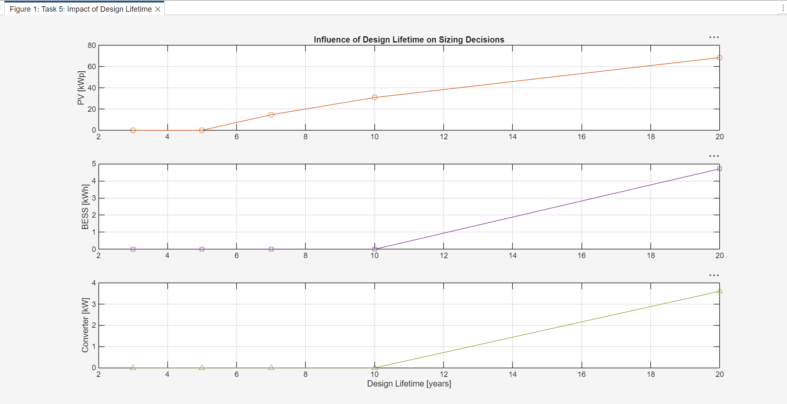
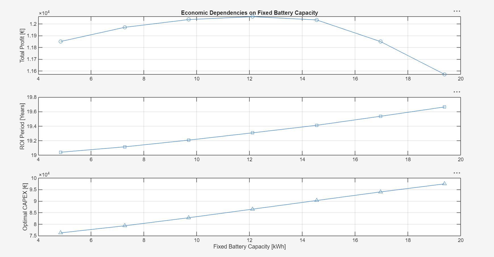

# Techno-Economic Co-Optimization of Behind-the-Meter PV-BESS Systems

A large-scale Linear Programming (LP) optimization framework developed in MATLAB to jointly solve the physical sizing and 8,760-hour operational dispatch of a grid-connected commercial Photovoltaic (PV) and Battery Energy Storage System (BESS).

---

## Project Overview

Sizing renewable generation and energy storage using static heuristics often leads to sub-optimal capital allocation and uncoordinated grid interactions. This project implements a full annual co-optimization model that simultaneously minimizes annualized capital expenditures (CAPEX) and operating expenditures (OPEX) across an entire year ($N = 8,760$ hours) at hourly resolution.

The model incorporates realistic market dynamics—including asymmetric time-of-use tariffs, demand peak charges, net-import regulatory constraints, and multi-regime battery degradation (calendar vs. cycle throughput wear)—and is cross-validated against the **HyEfRe** Decision Support Tool.

---

## Technical Highlights

* **Large-Scale LP Formulation:** Formulated and solved an optimization problem consisting of **43,818 decision variables** over an 8,760-hour planning horizon.
* **Sparse Matrix Architecture:** Implemented large-scale sparse block-diagonal matrices (`spdiags`, `kron`) to optimize memory footprint and ensure solver execution in seconds.
* **Linearized Complex Pricing & Degradation:** Linearized dual-rate electricity tariffs (import vs. feed-in export), monthly peak demand billing penalties, and non-smooth battery cell aging using auxiliary slack variables.
* **Sensitivity Analyses:** Executed multi-variable parametric sweeps across project design lifetimes (3 to 20 years) and forced battery storage capacities to confirm global economic optimality.

---

## Mathematical Formulation

### 1. Objective Function
The system minimizes the total annualized cost over the system design lifetime ($N_{\text{DL}}$):

$$\min_{\mathbf{z}} \quad J = \text{OPEX}_{\text{inv}} + \frac{\text{CAPEX}}{N_{\text{DL}}}$$

Where:
* **CAPEX:** Upfront investment costs for PV panels, battery pack, power electronic converter, and grid capacity modifications:
  $$\text{CAPEX} = p_{\text{PV,inv}} S^{\text{PV}} + p_{\text{batt,inv}} S^{\text{batt}} + p_{\text{PC,inv}} S^{\text{PC}} + C_{\text{inv}}^{\text{grid}}$$
* **OPEX:** Annualized operational costs including grid energy import/export, monthly peak demand charges, fixed maintenance, and battery degradation funds:
  $$\text{OPEX}_{\text{inv}} = \sum_{k=0}^{N-1} \epsilon_E(k) + p_{\text{pp}} \sum_{j=1}^{12} \epsilon_{\text{pp},j} + C_{\text{mnt}} + C_{\text{deg}}$$

### 2. Decision Variable Vector ($\mathbf{z} \in \mathbb{R}^{43,818}$)
$$\mathbf{z} = \begin{bmatrix}  \underbrace{S^{\text{PV}}, S^{\text{batt}}, S^{\text{PC}}, P_{\text{max,delta}}^{\text{grid}}}_{\text{System Sizing (4)}} &  \underbrace{E^{\text{BESS}}(k)}_{\text{Energy State } (N)} &  \underbrace{P^{\text{PV}}(k), P_{\text{ch}}^{\text{BESS}}(k), P_{\text{dch}}^{\text{BESS}}(k)}_{\text{Hourly Dispatch } (3N)} &  \underbrace{\epsilon_E(k)}_{\text{Energy Tariff } (N)} &  \underbrace{\epsilon_{\text{pp},j}}_{\text{Peak Slack } (12)} &  \underbrace{C_{\text{deg}}^{\text{batt}}, C_{\text{inv}}^{\text{grid}}}_{\text{Aging / Grid } (2)} \end{bmatrix}^T$$

Total decision variables for $N = 8,760$:
$$\text{Variables} = 4 + 4N + N + 12 + 1 + 1 = 5(8760) + 18 = \mathbf{43,818}$$

### 3. Key Constraints
* **State of Charge Dynamics (Conservation of Energy):**
  $$E^{\text{BESS}}(k+1) = E^{\text{BESS}}(k) + \eta_{\text{ch}} P_{\text{ch}}^{\text{BESS}}(k) T_d - \frac{1}{\eta_{\text{dch}}} P_{\text{dch}}^{\text{BESS}}(k) T_d$$
* **Cyclic Continuity:** Boundary condition ensuring storage neutrality across the annual horizon:
  $$E^{\text{BESS}}(N-1) = E^{\text{BESS}}(0)$$
* **C-Rate Throughput Bounds:** Restricts converter sizing relative to battery storage capacity:
  $$S^{\text{PC}} \le \beta_{\text{batt}} S^{\text{batt}}$$
* **Payoff Period Hurdle Rate:** Enforces that cumulative operational savings amortize capital investments within a defined target ($N_{\text{payoff}} = 11\text{ years}$):
  $$\text{OPEX}_{\text{inv}} + \frac{\text{CAPEX}}{N_{\text{payoff}}} \le \text{OPEX}_{\text{noinv}}$$
* **Annual Net-Import Mandate:** Guarantees that the commercial facility does not become a net electricity exporter over the year:
  $$\sum_{k=0}^{N-1} P^{\text{grid}}(k) \ge 0$$

---

## Results & Analysis

### 1. Baseline Optimal Dispatch (Task 3)
* **Optimal Sizing:** $S^{\text{PV}} = 72.4\text{ kWp}$, $S^{\text{batt}} = 12.1\text{ kWh}$


* **Operational Dynamics:** The battery charges during midday solar peaks and discharges during early morning and late evening demand windows. During maximum solar production, the system actively exports up to 43 kW back to the utility grid, generating feed-in revenue while maintaining zero net export across the full year.

---

### 2. Planning Horizon Sensitivity (Task 5)
Evaluates sizing decisions under variable project design lifetimes ($N_{\text{DL}} \in \{3, 5, 7, 10, 20\}\text{ years}$).



* **Short Lifetimes ($\le 5\text{ years}$):** High annualized asset costs ($\text{CAPEX}/N_{\text{DL}}$) disincentivize any technology investment ($S^{\text{PV}} = 0$, $S^{\text{batt}} = 0$).
* **Intermediate Lifetimes ($7 - 10\text{ years}$):** Solar PV investment becomes economically viable ($\sim15 - 31\text{ kWp}$) due to low maintenance overhead, while storage remains non-viable.
* **Long Lifetimes ($20\text{ years}$):** Compounded peak-shaving and energy arbitrage savings justify storage deployment ($S^{\text{batt}} \approx 4.7\text{ kWh}$, $S^{\text{PC}} \approx 3.6\text{ kW}$, $S^{\text{PV}} \approx 68\text{ kWp}$).

---

### 3. Storage Capacity Sweep & Optimality (Task 6)
Parametric evaluation fixing $S^{\text{batt}}$ across 7 discrete values around the unconstrained optimum ($12.1\text{ kWh}$).



* **Total Profit (Top):** Follows a concave parabolic curve peaking precisely at the baseline solution ($12.1\text{ kWh}$), yielding a maximum net profit of $\approx €12,050$ over the project lifespan and mathematically verifying global optimality.
* **Payback Period (Middle):** Monotonically increases from 19.04 to 19.66 years as storage size increases due to diminishing marginal returns on energy arbitrage relative to upfront cell costs.
* **CAPEX (Bottom):** Shows clean linear escalation ($€76,000 \to €97,500$) driven by incremental battery pack procurement and coupled inverter capacity sizing.

---

## Repository Structure

```text
├── data/
│   ├── STU_003_load_1h.csv       # Hourly facility load profile (kW)
│   ├── STU_003_pv_1h.csv         # Normalized PV production profile (kW/kWp)
│   └── STU_003_price_1h.csv      # Day-ahead spot market prices (€/kWh)
├── figures/
│   ├── task3_operational_profile.png
│   ├── task5_lifetime_sensitivity.png
│   └── task6_battery_capacity_sweep.png
├── src/
│   └── run_optimization.m        # Main script, sparse matrix builder & LP solver
├── .gitignore
└── README.md